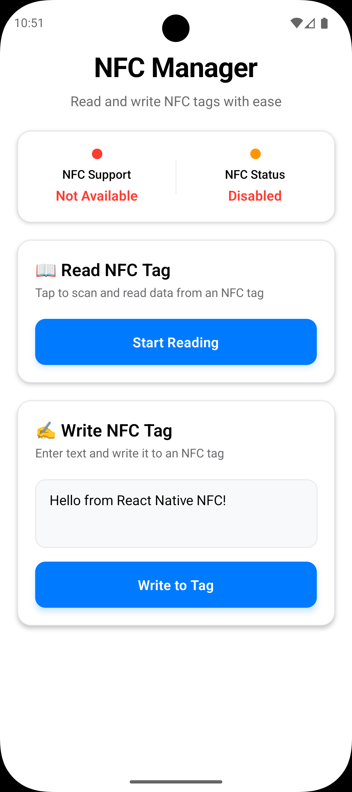
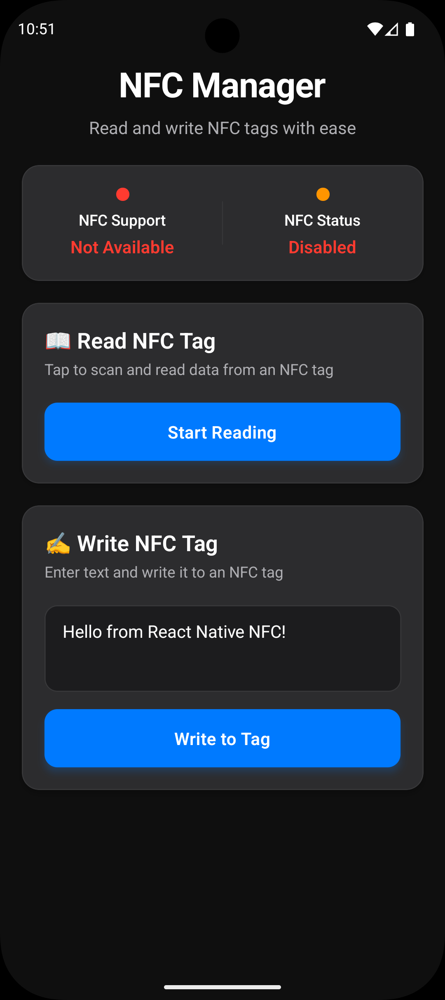

# NFC Manager

<div align="center">
  
  
  
</div>

<p align="center">
  An Android app for reading and writing NDEF data on NFC tags, built with React Native and TypeScript.
</p>

---

## Features

- **Read tags.** Scan a tag and see its ID, supported technologies, and decoded NDEF records. Text and URI records are decoded; other record types show their raw payload.
- **Write text or URLs.** Pick a mode with the Text/URL toggle, then write to the tag.
- **Cancel a pending scan.** A Cancel button stops a read or write that is waiting for a tag.
- **NFC status.** The app checks whether the device supports NFC and whether it is turned on.
- **Light and dark themes** that follow the system setting.

## Write Modes

The toggle above the input field picks the type of NDEF record the app writes.

| Mode | Record             | What a phone does when it taps the tag                          |
| ---- | ------------------ | --------------------------------------------------------------- |
| Text | NDEF Text (`T`)    | Shows the text in an NFC reader app, such as this one.          |
| URL  | NDEF URI (`U`)     | Opens the link in the browser. No app needs to be installed.    |

Each mode keeps its own input, so switching modes does not clear what you typed.

URL mode accepts only links that start with `http://` or `https://` and contain no spaces. The app trims leading and trailing whitespace before checking. Text mode writes the input exactly as typed, but rejects empty or whitespace-only input.

Only one read or write can run at a time. Starting a second one while the first waits for a tag does nothing.

## Screenshots

<div align="center">
  
  
</div>

## Getting Started

### Prerequisites

- Node.js 18 or later
- Android Studio with an Android SDK set up for React Native ([environment setup guide](https://reactnative.dev/docs/set-up-your-environment))
- A physical Android device with NFC. Emulators do not support NFC.
- NFC tags for testing. NTAG213, NTAG215, and NTAG216 all work.

### Install and Run

```bash
git clone https://github.com/atharvdange618/NFC-Manager.git
cd NFC-Manager
npm install
npm start          # Metro bundler, in one terminal
npm run android    # build and install, in another
```

The repository tracks the debug keystore, so a fresh clone builds without extra signing setup.

### Permissions

`android/app/src/main/AndroidManifest.xml` already declares what the app needs:

```xml
<uses-permission android:name="android.permission.NFC" />
<uses-feature android:name="android.hardware.nfc" android:required="true" />
```

## Project Structure

```text
NFC-Manager/
├── App.tsx                     # Screen layout; wires the hook to the components
├── src/
│   ├── nfc/
│   │   ├── useNfc.ts           # NFC state, read, write, cancel, and input checks
│   │   ├── withNdef.ts         # Requests the NDEF technology and always releases it
│   │   ├── ndef.ts             # Record type detection and payload decoding
│   │   └── __tests__/
│   │       ├── ndef.test.ts
│   │       └── useNfc.test.tsx
│   ├── components/
│   │   ├── Card.tsx
│   │   ├── MessageBanner.tsx   # Info, success, and error messages
│   │   ├── PrimaryButton.tsx
│   │   ├── RecordKindToggle.tsx  # Text/URL mode switch
│   │   ├── SectionHeader.tsx
│   │   ├── StatusCard.tsx      # NFC supported and enabled indicators
│   │   └── TagInfoCard.tsx     # Details of the last scanned tag
│   └── theme/
│       └── useTheme.ts         # Light and dark color tokens
├── android/
├── jest.config.js
└── package.json
```

### How the pieces fit

`useNfc` owns all NFC logic and exposes `readNfc`, `writeNfc(input, kind)`, and `cancelScan`, along with status flags, the last scanned tag, a `pending` value (`'read'`, `'write'`, or `null`), and a typed `message`. Components only render what the hook returns.

`withNdef` wraps every tag operation. It requests the NDEF technology, runs the operation, and cancels the request in a `finally` block so the NFC session never stays open after an error.

`ndef.ts` handles a platform difference: Android reports record types as byte arrays (`[0x54]`), while the library's own encoder uses strings (`'T'`). `recordTypeName` turns both into the same string before the app checks the type.

When the user cancels, the library throws `NfcError.UserCancel`. The hook shows a "cancelled" info message for it and logs nothing, since a cancel is not an error.

## Testing

The tests use Jest with the `react-native` preset and the mock that ships with `react-native-nfc-manager`, so they run without a device.

```bash
npm test                          # run all tests
npx jest --watch                  # rerun on file changes
npx jest src/nfc/__tests__/ndef.test.ts   # run one file
```

What the suites cover:

- **`ndef.test.ts`**: record type detection on both platforms, and text and URI decoding.
- **`useNfc.test.tsx`**: startup checks, reads, writes in both modes, URL validation, cancelling reads and writes, and the one-operation-at-a-time rule.

Before committing, run lint, the type check, and the tests:

```bash
npm run lint
npx tsc --noEmit
npm test
```

### Manual testing on a device

Unit tests mock the native module, so check these on real hardware:

1. Read a blank tag, a text tag, and a URL tag.
2. Write text, then read it back.
3. Write a URL, close the app, and tap the tag. The browser should open the link.
4. Start a read or write, then press Cancel.
5. Turn NFC off in system settings and confirm the app reports it.

## Tech Stack

| Package                    | Version  |
| -------------------------- | -------- |
| `react-native`             | 0.80.0   |
| `react`                    | 19.1.0   |
| `react-native-nfc-manager` | ^3.16.1  |
| `typescript`               | 5.0.4    |
| `jest`                     | ^29.6.3  |

## Troubleshooting

- **"NFC not supported"**: the device has no NFC hardware, or you are on an emulator.
- **"NFC disabled"**: turn on NFC in system settings, then restart the app.
- **A URL tag opens this app instead of the browser**: Android may route the tag to the app in the foreground. Close the app and tap again.
- **A write fails**: the tag may be locked, too small for the data, or moved away too early. Hold it still until the success message appears.

## Privacy

The app makes no network requests and stores nothing. Tag data lives in memory only for the current session.

## Contributing

Issues and pull requests are welcome. Please run lint, the type check, and the tests before you open a pull request, and use [Conventional Commits](https://www.conventionalcommits.org/) for commit messages.

## License

MIT

## Author

Built by Atharv Dange. Find me on X at [@atharvdangedev](https://x.com/atharvdangedev).
