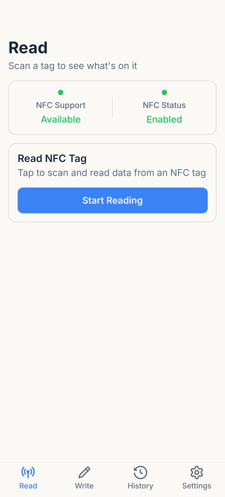
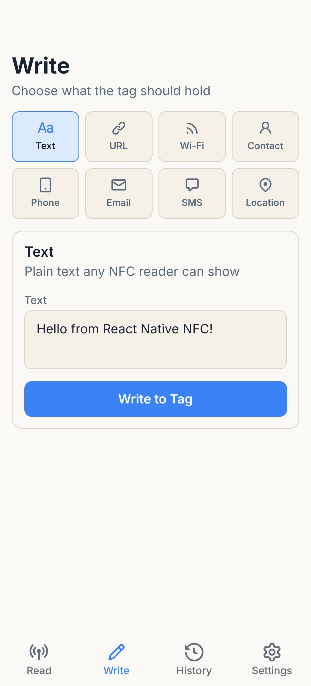
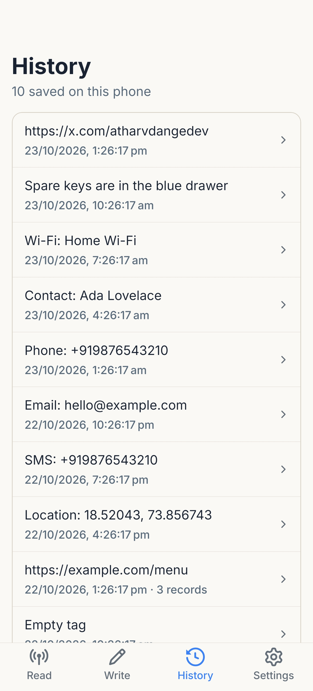
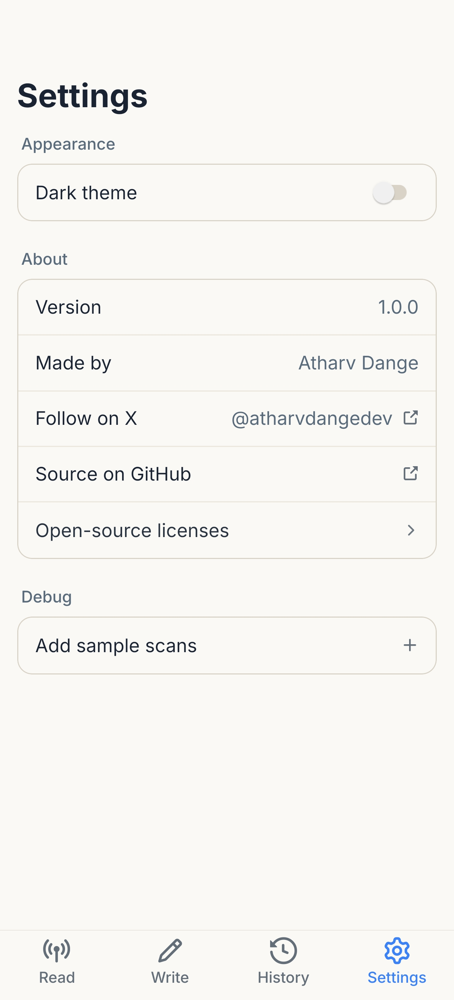
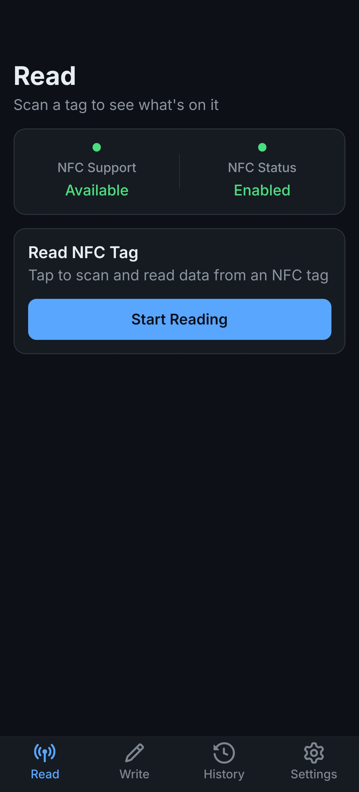
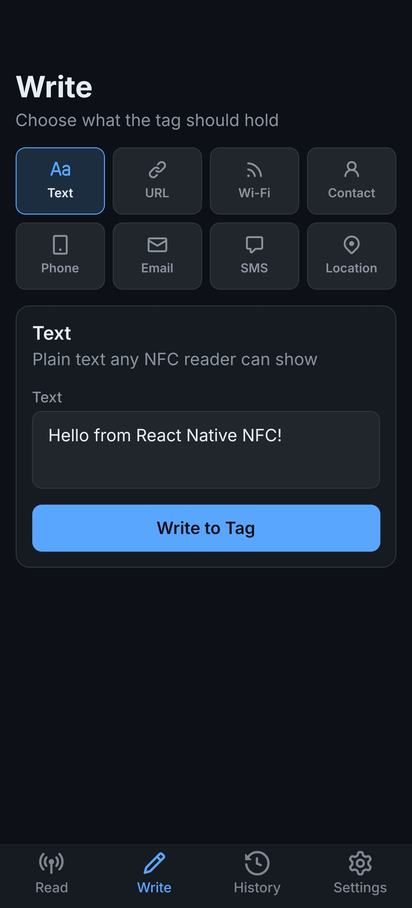
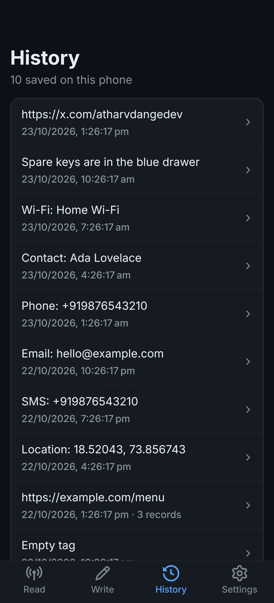
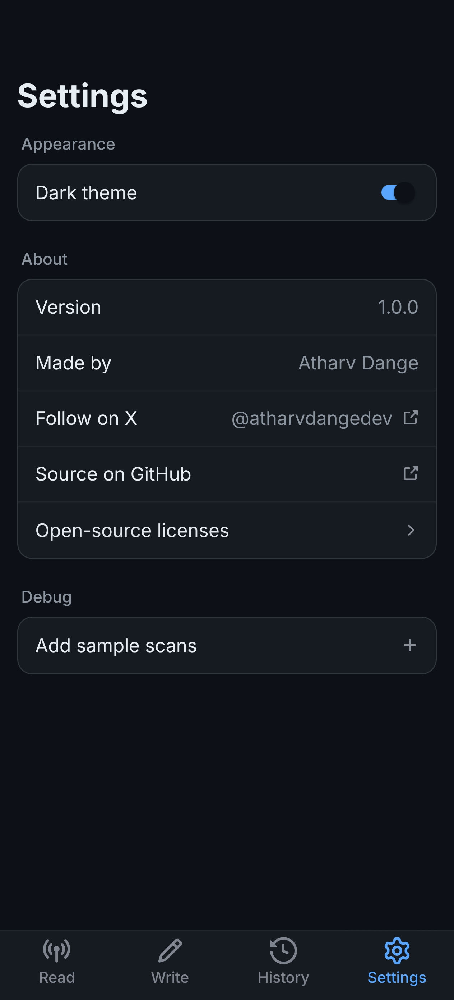
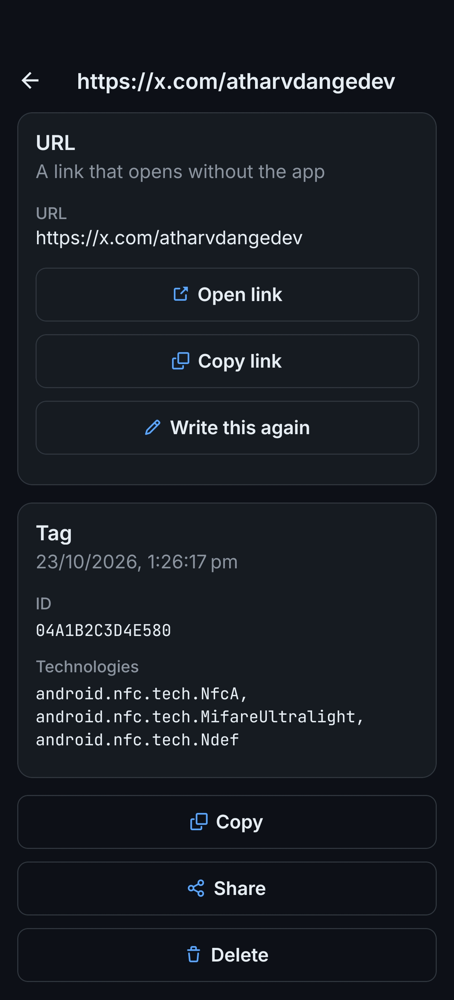

# NFC Manager

<div align="center">
  
  
  
</div>

<p align="center">
  An Android app for reading and writing NDEF data on NFC tags, built with React Native and TypeScript.
</p>

---

## Features

- **Read tags.** Scan a tag and see its ID, supported technologies, and decoded NDEF records. Text and URI records are decoded; other record types show their raw payload.
- **Scan from anywhere.** Tap a tag with the app closed or in the background and pick NFC Manager from Android's app chooser; the scan opens in the result sheet. While the app is open, taps stay inside it instead of going to other tag apps.
- **Write text or URLs.** Pick a mode with the Text/URL toggle, then write to the tag.
- **Cancel a pending scan.** A Cancel button stops a read or write that is waiting for a tag.
- **NFC status.** The app checks whether the device supports NFC and whether it is turned on.
- **Light and dark themes** that follow the system setting.

## Write Modes

The toggle above the input field picks the type of NDEF record the app writes.

| Mode | Record             | What a phone does when it taps the tag                          |
| ---- | ------------------ | --------------------------------------------------------------- |
| Text | NDEF Text (`T`)    | Shows the text in an NFC reader app, such as this one.          |
| URL  | NDEF URI (`U`)     | Opens the link in the browser, or lists NFC Manager alongside it in Android's app chooser when this app is installed. |

While the app is open it holds the NFC session, so the tag goes to the app instead of Android's chooser, whatever the record holds.

Each mode keeps its own input, so switching modes does not clear what you typed.

URL mode accepts only links that start with `http://` or `https://` and contain no spaces. The app trims leading and trailing whitespace before checking. Text mode writes the input exactly as typed, but rejects empty or whitespace-only input.

Only one read or write can run at a time. Starting a second one while the first waits for a tag does nothing.

## Screenshots

<div align="center">
  
  
  
  
</div>

<div align="center">
  
  
  
  
  
</div>

## Getting Started

### Prerequisites

- Node.js 18 or later
- Android Studio with an Android SDK set up for React Native ([environment setup guide](https://reactnative.dev/docs/set-up-your-environment))
- A physical Android device with NFC. Emulators do not support NFC.
- NFC tags for testing. NTAG213, NTAG215, and NTAG216 all work.

### Install and Run

```bash
git clone https://github.com/atharvdange618/NFC-Manager.git
cd NFC-Manager
npm install
npm run android    # generates android/, builds the dev client, installs it
npm start          # later runs: start Metro for the installed dev client
```

The app needs a development build. Expo Go can't load the NFC native module. `android/` is generated by `expo prebuild` from `app.config.ts`, so it isn't tracked in git.

### Permissions

`plugins/withNfcManifest.js` and the `react-native-nfc-manager` config plugin add what the app needs to the generated manifest:

```xml
<uses-permission android:name="android.permission.NFC" />
<uses-feature android:name="android.hardware.nfc" android:required="true" />
```

## Project Structure

```text
NFC-Manager/
├── App.tsx                     # Screen layout; wires the hook to the components
├── src/
│   ├── nfc/
│   │   ├── useNfc.ts           # NFC state, read, write, cancel, and input checks
│   │   ├── withNdef.ts         # Requests the NDEF technology and always releases it
│   │   ├── ndef.ts             # Record type detection and payload decoding
│   │   └── __tests__/
│   │       ├── ndef.test.ts
│   │       └── useNfc.test.tsx
│   ├── components/
│   │   ├── Card.tsx
│   │   ├── MessageBanner.tsx   # Info, success, and error messages
│   │   ├── PrimaryButton.tsx
│   │   ├── RecordKindToggle.tsx  # Text/URL mode switch
│   │   ├── SectionHeader.tsx
│   │   ├── StatusCard.tsx      # NFC supported and enabled indicators
│   │   └── TagInfoCard.tsx     # Details of the last scanned tag
│   └── theme/
│       └── useTheme.ts         # Light and dark color tokens
├── plugins/
│   └── withNfcManifest.js      # NFC intent filters, tech list and hardware requirement
├── app.config.ts               # Expo config; prebuild generates android/ from it
├── jest.config.js
└── package.json
```

### How the pieces fit

`useNfc` owns all NFC logic and exposes `readNfc`, `writeNfc(input, kind)`, and `cancelScan`, along with status flags, the last scanned tag, a `pending` value (`'read'`, `'write'`, or `null`), and a typed `message`. Components only render what the hook returns.

`withNdef` wraps every tag operation. It requests the NDEF technology, runs the operation, and cancels the request in a `finally` block so the NFC session never stays open after an error.

`tagSession.ts` holds an Android reader-mode session for as long as the app is open, so the system hands taps to the app instead of showing its own tag-app chooser. `useNfc` also listens for tags that arrive without a read or write waiting: the intent that starts the app, or a dispatch while it is in the background. Those get saved to history and opened in the result sheet. A repeat of the same tag within two seconds is ignored, because Android reports a background tap twice, once as the intent and once through the reader session.

`ndef.ts` handles a platform difference: Android reports record types as byte arrays (`[0x54]`), while the library's own encoder uses strings (`'T'`). `recordTypeName` turns both into the same string before the app checks the type.

When the user cancels, the library throws `NfcError.UserCancel`. The hook shows a "cancelled" info message for it and logs nothing, since a cancel is not an error.

## Testing

The tests use Jest with the `jest-expo` preset and the mock that ships with `react-native-nfc-manager`, so they run without a device.

```bash
npm test                          # run all tests
npx jest --watch                  # rerun on file changes
npx jest src/nfc/__tests__/ndef.test.ts   # run one file
```

What the suites cover:

- **`ndef.test.ts`**: record type detection for byte-array and string types, and text and URI decoding.
- **`tagInfo.test.ts`**: chip detection from `GET_VERSION`, NDEF bytes used, including records in the shape Android returns.
- **`tagSession.test.ts`**: the reader-mode flags, including that the NDEF check stays on so writes still get the Ndef technology.
- **`useNfc.test.tsx`**: startup checks, reads, writes in both modes, URL validation, cancelling reads and writes, the one-operation-at-a-time rule, and tags that arrive from a launch intent or a background dispatch.

Before committing, run lint, the type check, and the tests:

```bash
npm run lint
npx tsc --noEmit
npm test
```

### Manual testing on a device

Unit tests mock the native module, so check these on real hardware:

1. Read a blank tag, a text tag, and a URL tag.
2. Write text, then read it back.
3. Write a URL, close the app, and tap the tag. Android should offer NFC Manager next to the browser; picking NFC Manager opens the scan.
4. Send the app to the background, tap a tag, and pick NFC Manager: the scan should open in the sheet.
5. Tap a tag while the app is open: no app chooser, and the scan opens in the sheet.
6. Start a read or write, then press Cancel.
7. Turn NFC off in system settings and confirm the app reports it.

## Tech Stack

| Package                    | Version  |
| -------------------------- | -------- |
| `expo`                     | ~57.0.31 |
| `react-native`             | 0.86.3   |
| `react`                    | 19.2.3   |
| `react-native-nfc-manager` | ^4.0.0   |
| `typescript`               | ~6.0.3   |
| `jest`                     | ^29.6.3  |

## Troubleshooting

- **"NFC not supported"**: the device has no NFC hardware, or you are on an emulator.
- **"NFC disabled"**: turn on NFC in system settings, then restart the app.
- **Android's app chooser appears instead of the scan**: the app holds a reader-mode session only while it is running. With the app closed, Android routes the tag itself and shows a chooser when more than one installed app can handle it; pick NFC Manager. With the app open the chooser is bypassed and the scan opens directly.
- **A write fails**: the tag may be locked, too small for the data, or moved away too early. Hold it still until the success message appears.

## Privacy

The app makes no network requests. Scan history is stored on the phone only, in MMKV, and never leaves it.

## Contributing

Issues and pull requests are welcome. Please run lint, the type check, and the tests before you open a pull request, and use [Conventional Commits](https://www.conventionalcommits.org/) for commit messages.

## License

MIT

## Author

Built by Atharv Dange. Find me on X at [@atharvdangedev](https://x.com/atharvdangedev).
